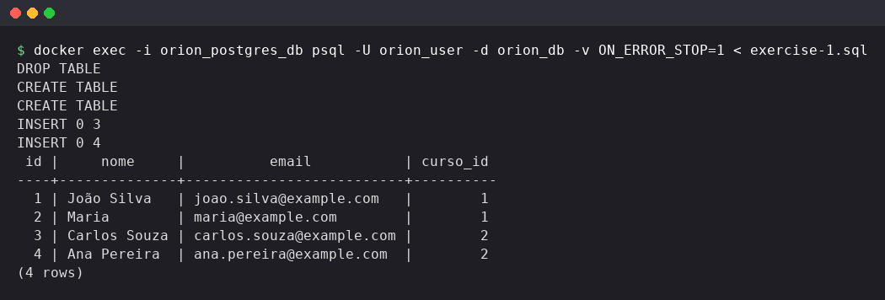
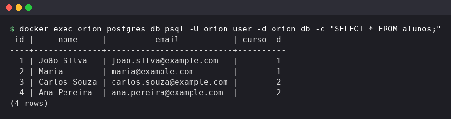
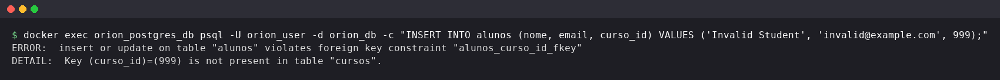

# Exercise 1: Relational database (basic SQL)

Create the `cursos` and `alunos` tables with a primary key and a foreign key, insert test data and query it.

## How to run

Start the environment first (see [databases/README.md](../README.md)), then run from this folder:

```bash
docker exec -i orion_postgres_db psql -U orion_user -d orion_db -v ON_ERROR_STOP=1 < exercise-1.sql
```

The script drops the tables first, so it can be run again at any time.

## Results

### Tables and data

`exercise-1.sql` creates `cursos` and `alunos`, inserts 3 courses and 4 students, and ends with `SELECT * FROM alunos;`.



### Students

`SELECT * FROM alunos;` returns the 4 inserted students.



### Foreign key

The foreign key rejects a student whose `curso_id` does not exist in `cursos`. This insert is commented at the end of the script and was run on its own for this print:


