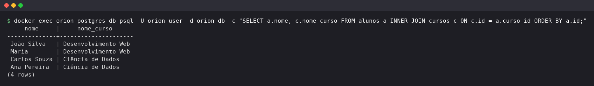
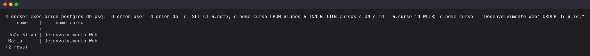
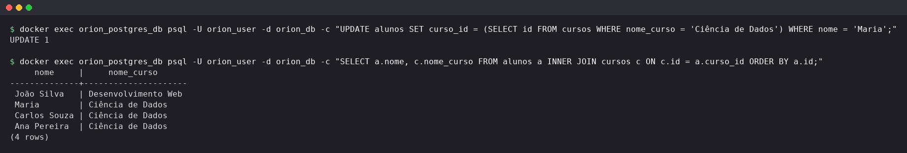
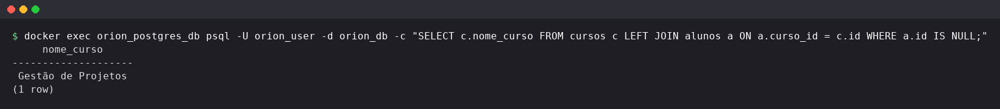

# Exercise 2: Relational database (JOINs and filters)

Query the `alunos` and `cursos` tables with `INNER JOIN`, filter with `WHERE`, update a student and find the courses without students.

## How to run

This exercise uses the schema and data from [exercise 1](../exercise-1/README.md). Start the environment first (see [databases/README.md](../README.md)), then run from this folder:

```bash
docker exec -i orion_postgres_db psql -U orion_user -d orion_db -v ON_ERROR_STOP=1 < ../exercise-1/exercise-1.sql
docker exec -i orion_postgres_db psql -U orion_user -d orion_db -v ON_ERROR_STOP=1 < exercise-2.sql
```

The script moves Maria to another course. Run `exercise-1.sql` again to restore the original data.

## Results

The prints below run each query of `exercise-2.sql` on its own, starting from the data created by exercise 1.

### 1. INNER JOIN

Student name and course name in a single query.



### 2. JOIN + WHERE

Only the students in "Desenvolvimento Web".



### 3. UPDATE

Maria is moved to "Ciência de Dados". The same JOIN as item 1 shows the change.



### Extra: LEFT JOIN + WHERE

Courses without any enrolled student.


